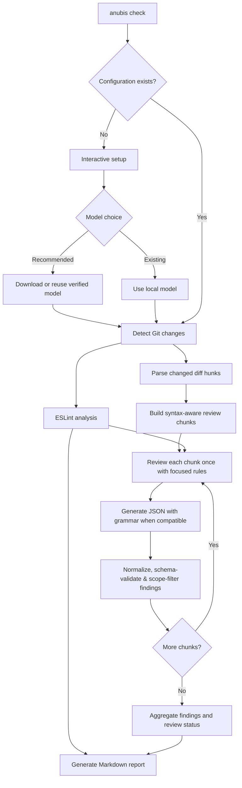

<div align="center">


# Anubis

### Before the Merge Comes the Judgment.

**AI-Powered Code Review · 100% Local · Built for React Native**

Local AI-Powered code review tool that "weighs" every line of code to judge its quality and integrity before it moves forward in your project's lifecycle.

Anubis reviews your Git changes, combines ESLint with local AI analysis, and produces an actionable Markdown report—without uploading your source code to a hosted AI service.

[Quick Start](#-quick-start) · [Features](#-features) · [Model Recommendations](#-model-recommendations) · [Configuration](#%EF%B8%8F-configuration) · [Roadmap](#%EF%B8%8F-roadmap)

</div>

---

## ⚖️ Why Anubis?

In ancient Egyptian mythology, Anubis weighed the heart to judge what lay beneath the surface. Anubis applies the same idea to code: looking beyond formatting and syntax to identify behavioral problems before changes are merged.

Linters are essential, but they don't catch every lifecycle issue, asynchronous race condition, or unintended consequence of a change. Anubis combines **static analysis** with **AI-assisted review**, focused on the kinds of bugs React Native developers encounter in real projects.

> [!IMPORTANT]
> Anubis is an assistant, not a substitute for human review or automated tests. AI findings and suggested fixes can be wrong or incomplete; verify them before applying changes.

## ✨ Features

- **🔒 Private by design:** Code review runs on your computer. No hosted AI API, API key, or account is required for the recommended model.
- **🌍 Cross-platform by design:** Built to run locally on macOS, Windows, and Linux. Compatibility and performance may vary depending on your hardware and system configuration.
- **⬇️ Automatic model setup:** Download the recommended model directly during initialization, with progress tracking and integrity verification.
- **♻️ Download once, reuse everywhere:** Share one locally cached model across multiple projects instead of downloading it for each repository.
- **⚛️ React Native-focused:** Review Hooks, cleanup, navigation, async flows, security, accessibility, and meaningful performance concerns.
- **🎯 Direct behavior-focused rules:** Use one focused React Native rule set that explicitly checks async completion ownership, repeated actions, concurrent state changes, failure boundaries, hooks, and lifecycle behavior.
- **🌿 Git-aware:** Detect staged, unstaged, and untracked JavaScript and TypeScript changes.
- **🔍 ESLint + AI:** Use your project's ESLint configuration when one is detected; otherwise, use Anubis's bundled rules. The AI is instructed to avoid duplicating ESLint findings and focus on deeper runtime issues, but this is best-effort and depends on the model.
- **🧠 Configurable thinking strategy:** Choose auto, bounded, unbounded, or zero thinking budget during setup to control model generation behavior.
- **🧩 Diff-focused, syntax-aware AI review:** Limit AI findings to changed Git lines, group those changes into syntax-aware chunks, and provide surrounding code plus relevant declarations as read-only context. ESLint still analyzes each detected changed file as a whole.
- **🧩 Model-aware structured output:** Use schema-constrained JSON where compatible and skip grammar for Qwen3 thinking output, where constrained JSON may be emitted only in the thought segment.
- **📊 Actionable reports:** Get severity, file and line, issue, impact, and suggested fix in a branded Markdown report.
- **🛠️ Simple CLI:** Initialize once and run reviews with `anubis check`.
- **♾️ No usage quotas or subscriptions:** Run as many local reviews as your hardware can handle. No credits to buy, no rate-limit countdowns, and no “come back later” messages. Your GPU might ask for a coffee break, though. ☕

## 🚀 Quick Start

### Prerequisites

- **Node.js:** Node.js 22.13+ or 24+ is recommended for the current dependencies. (Node.js 20.19+ may also be supported; verify your environment.)
- **Git:** Run Anubis inside a Git repository.
- **A React Native project:** Current change detection supports `.js`, `.jsx`, `.ts`, and `.tsx`.
- **Available memory and disk space:** The recommended model is a multi-gigabyte download and needs additional memory to run. Performance depends on your hardware.
- **Internet access for first-time setup:** Required to download the recommended model; subsequent reviews run locally.

### 1. Install Anubis

**Install globally with npm:**

```bash
npm install --global @hossam.elgzeery/anubis
```

**For local development:**

```bash
git clone https://github.com/Hossam-Elgzeery/Anubis.git
cd Anubis
npm install
npm run build
npm link
```

### 2. Initialize in your React Native project

```bash
cd path/to/your-react-native-project
anubis init
```

Choose the recommended model when prompted:

```text
⚖️ Anubis Initial Setup

Choose your AI model:
  1. Download Qwen3.5-4B Q6_K (Recommended)
  2. Use an existing local model

Select an option (1):

The recommended model is a multi-gigabyte download.
Download or reuse this model? [Y/n] (Y):

⬇️  Downloading: ...
✔ Model downloaded and verified.

Context size (8192):
Temperature (0):
Max output tokens (3072):

Choose thinking mode:
  1. Auto (Default)
  2. Bounded
  3. Unbounded
  4. Zero thinking budget
Select an option (1):

Report filename (ANUBIS_REPORT.md):

✅ Anubis initialized successfully!
```

If you select **Bounded** thinking (option `2`), Anubis also prompts for `Thinking token budget (1024):`. Other modes skip that question. The **Zero** option sets a zero thinking budget; it does not necessarily disable a model's internal reasoning behavior.

Anubis supports model-specific generation strategies, but the exact behavior depends on the GGUF model and its chat template.

Press **Enter** to accept the other defaults. Anubis can download the recommended model from [Hugging Face](https://huggingface.co/lmstudio-community/Qwen3.5-4B-GGUF), verifies its integrity, and saves it in a shared local cache at `~/.anubis/models/`.

If the model has already been downloaded and passes verification, Anubis reuses it. Initialization creates `anubis.config.json` in the current project and does not overwrite an existing configuration.

### 3. Review your changes

```bash
anubis check
```

Anubis analyzes the detected changes and writes **`ANUBIS_REPORT.md`** to your project by default. Subsequent reviews replace the report at the configured output path.

**Prefer one command?** If configuration is missing, `anubis check` starts the interactive setup automatically, then continues with the review. Interactive setup requires a terminal.

## 🧠 Model Recommendations

Anubis supports compatible local GGUF models, giving you the freedom to choose the model that best fits your hardware and review needs.

**Qwen3.5-4B Q6_K is our recommended default because it delivered the most promising results among the models we tested during Anubis development.** It provides a convenient, ready-to-use starting point through Anubis's automatic download and setup process.

However, **this recommendation is based on our own testing, not an exhaustive comparison of available models.** Other models, including larger or newer ones, may deliver better accuracy, more useful findings, or stronger performance for your specific codebase.

| Model tested | Observations from our tests | Recommendation |
| --- | --- | --- |
| **Qwen3.5-4B — Q6_K** | Most promising overall results in our hands-on React Native review tests, including more useful suggested fixes. | **Default recommendation** |
| **Qwen2.5-Coder-1.5B-Instruct — Q6_K** | Produced structured findings, but largely repeated ESLint results, overestimated severity, and provided limited additional analysis of runtime issues. | Not the default |
| **Qwen2.5-Coder-0.5B-Instruct — Q6_K** | Successfully generated valid structured JSON, but returned no AI findings in our test despite identifiable security and performance concerns. | Not the default |
| **Gemma-1.1-2B-IT** | Less consistent review quality and suggested fixes in our tests. | Not the default |
| **DeepSeek-Coder-1.3B-Kexer** | Kotlin-focused fine-tuned model; less reliable findings and suggested fixes in our React Native tests. | Not the default |

**Quick start:** Choose the recommended model during `anubis init` to use the built-in downloader.

**Prefer to experiment?** You're free to use another compatible GGUF model. Different models and quantizations may produce different results, so we encourage you to experiment and find what works best for your projects and hardware.

**Recommended download:** [Qwen3.5-4B Q6_K on Hugging Face](https://huggingface.co/lmstudio-community/Qwen3.5-4B-GGUF). Anubis includes an automatic downloader.

> [!NOTE]
> **These were exploratory, hands-on tests, not a controlled benchmark.** We intentionally experimented with models of different parameter sizes, quantizations, and training specializations to find a practical default for Anubis, rather than conduct a like-for-like comparison.
>
> The Qwen2.5-Coder models were tested using the Instruct variants with Q6_K quantization. Although both successfully generated structured output, their review quality was less reliable in our test cases. These observations should not be interpreted as a general assessment of their coding capabilities.
>
> In particular, DeepSeek-Coder-1.3B-Kexer was fine-tuned for Kotlin code generation rather than React Native code review. Its results should be interpreted in that context.
>
> Our recommendation reflects the results observed during development, not a claim that Qwen3.5-4B Q6_K is inherently superior to other models. Different models, configurations, and hardware may produce better results, and AI findings can still be inaccurate or incomplete.

**Review quality note:** Passing JSON parsing, schema validation, and changed-line checks does **not** establish that a finding is correct. Anubis validates the output structure and review scope, not the semantic truth of every claim.

**Model attribution:** The recommended [Qwen3.5-4B](https://huggingface.co/Qwen/Qwen3.5-4B) model is developed by the Qwen team and licensed under [Apache License 2.0](https://www.apache.org/licenses/LICENSE-2.0). Anubis is an independent project licensed separately under the MIT License.

### Why Q6_K?

**Q6_K is the quantization used for our successful Qwen3.5-4B tests.** We recommend the configuration we actually tested rather than assuming a smaller download produces equivalent code review results.

Smaller quantizations may require less memory and work better on devices with limited resources. However, we haven't tested them extensively with Anubis, so review quality may vary.

## 🧰 CLI Reference

| Command | What it does |
| --- | --- |
| `anubis init` | Interactive first-time setup and configuration |
| `anubis check` | Review detected Git changes and generate a report |
| `anubis --help` | Show available commands |
| `anubis --version` | Show the CLI version |

### Debugging

**macOS/Linux:**

```bash
ANUBIS_DEBUG=1 anubis check
```

**Windows PowerShell:**

```powershell
$env:ANUBIS_DEBUG="1"; anubis check
```

**Windows Command Prompt:**

```bat
set ANUBIS_DEBUG=1 && anubis check
```

Normal output shows each chunk's exact changed ranges separately from its wider context range and the number of accepted findings. Untracked files are labeled as full-file review scopes. Debug mode additionally prints clearly delimited review contexts, the raw model response, token information, and counts for raw, accepted, invalid, and out-of-scope findings. It also reports whether structured grammar is enabled for the selected model strategy.

> [!CAUTION]
> Debug logs may contain proprietary source code and sensitive application details. Review and sanitize them before sharing.

## ⚙️ Configuration

Initialization generates an `anubis.config.json` file. For most users, the defaults are sufficient.

```json
{
  "model": {
    "path": "/home/you/.anubis/models/<downloaded-model-file>",
    "contextSize": 8192,
    "temperature": 0,
    "maxTokens": 3072,
    "thinkingMode": "auto",
    "thoughtTokens": 1024
  },
  "review": {
    "output": "ANUBIS_REPORT.md"
  }
}
```

The example path is illustrative; Anubis writes the real path for your machine.

| Setting | Purpose | Default |
| --- | --- | --- |
| `model.path` | Location of the model on your computer | Automatically set during recommended setup |
| `model.contextSize` | Amount of context available to the model | `8192` |
| `model.temperature` | Controls generation randomness | `0` |
| `model.maxTokens` | Maximum generated output tokens | `3072` |
| `model.thinkingMode` | Thinking strategy: `auto`, `bounded`, `unbounded`, or `zero` | `auto` |
| `model.thoughtTokens` | Thinking token budget used by budget-aware generation modes | `1024` |
| `review.output` | Markdown report name or relative path | `ANUBIS_REPORT.md` |

**Thinking modes:** `auto` uses Anubis's automatic strategy, `bounded` uses the configured thinking-token budget, `unbounded` does not impose that budget, and `zero` requests a zero thinking budget. Actual behavior varies by model; `zero` is not a guarantee that reasoning is disabled. For a bounded run, Anubis asks for `thoughtTokens` during initialization.

The output can also be a relative path such as `reports/ANUBIS_REPORT.md`; Anubis creates the required directory.

**Team tip:** Model paths are machine-specific. Consider excluding `anubis.config.json` from version control if contributors have different local paths.

## 📊 Review Report

Each review produces a branded Markdown report with:

- **Review Summary:** Total static-analysis issues, ESLint errors and warnings, AI findings broken down by critical, high, medium, and low severity, and AI completion status.
- **Static Analysis:** ESLint findings with file locations, rule names, and descriptions.
- **AI Code Review:** Severity-ranked findings with issue, impact, and suggested fix.
- **Source links:** Relative links to affected files, with line anchors in viewers that support them.
- **Failure visibility:** An explicit AI failure status and error details when the AI stage cannot complete.
- **Basic duplicate filtering:** Exact duplicates by file, line, and normalized issue text are filtered; semantically equivalent findings with different wording may remain.

Example AI finding (*illustrative — fictional code*):

```markdown
### 🟠 1. HIGH

**📍 Location:** [UserProfile.tsx:42](src/screens/UserProfile.tsx#L42)

**🐛 Issue**

An earlier profile request can finish after a newer one and overwrite the
screen with stale user data.

**⚠️ Impact**

Switching between profiles quickly may display information belonging to the
previously selected user.

**💡 Suggested Fix**

Ignore outdated responses or cancel the previous request when the user ID
changes, and update state only for the latest active request.
```

> Relative file links work across many Markdown viewers, but navigating to an exact line depends on the viewer. GitHub supports `#L` line anchors.

## 🔄 How Anubis Works



Anubis follows these principles:

1. **Limit AI findings to changed lines:** Combine staged and unstaged edits against the working tree, parse their Git hunks, and accept AI findings only on added or modified lines. A deletion-only change is anchored to the line now occupying the removed line's position. Untracked files are reviewed in full.
2. **Use file-level static analysis as context:** Run ESLint on each detected changed file, include all of its findings in the static-analysis report, and pass findings from the current chunk's changed ranges to the AI. The AI is instructed not to repeat findings with the same root cause and impact, while still reporting deeper runtime bugs that ESLint may only hint at.
3. **Build syntax-aware context:** Prefer TypeScript AST statement and block boundaries, including nested function bodies and class members. Add surrounding lines in both directions, extend overlap to complete syntax boundaries instead of sending partial operations, and include referenced declarations elsewhere in the same file when they fit the context budget.
4. **Keep context and ownership separate:** Surrounding source and related declarations help the model reason, but only exact changed ranges belong to the review scope. Findings outside those ranges are discarded.
5. **Keep one source of review rules:** Define React Native-specific guidance only in `rules/react-native.md` and inject that rule set once into each per-chunk task prompt. The system prompt remains generic, so domain rules stay close to the reviewed code without being duplicated.
6. **Review each chunk once:** Keep the inference path simple—one task prompt, one response schema, deterministic location/scope validation, and no candidate/verifier pipeline.
7. **Control generation:** Apply the configured thinking strategy and token budget where supported by the model.
8. **Use model-aware structured output:** Request schema-constrained JSON for compatible generation modes. Skip grammar for Qwen3 thinking output to avoid empty final responses caused by JSON appearing only in the thought segment.
9. **Report failures honestly:** Continue processing other chunks when inference fails, preserve successful findings and static-analysis results, mark the AI report as failed, and include the failed chunk count and details rather than treating missing results as a clean review.

## 🔐 Privacy & Offline Reviews

**Your code stays on your machine during review.** Anubis does not need a hosted AI service, an API key, or an account to analyze your changes. After the model and package are installed, the review workflow does not require an internet connection.

The initial model download connects to Hugging Face. As with any developer tool, evaluate dependencies and local environment policies before using it with confidential repositories.

## 🛡️ Dependency Security Notice

Some installations may report security advisories in dependencies inherited from `node-llama-cpp`, which Anubis uses for local model inference. In the dependency versions tested for Anubis `0.1.0`, the affected chain was:

```text
node-llama-cpp → simple-git@3.36.0 → @simple-git/argv-parser@1.1.1
```

The reported advisory is [GHSA-v5rq-49vh-5v5c](https://github.com/advisories/GHSA-v5rq-49vh-5v5c), concerning Git editor environment-variable handling. The presence of an audit warning does not, by itself, establish that normal Anubis reviews expose an exploitable path. However, the dependency advisory should not be ignored when evaluating your environment.

### Optional workaround for local npm installations

In a project that installs Anubis **locally** as a dependency, you can add an npm override to the **root project's** `package.json`:

```json
{
  "overrides": {
    "simple-git": "4.0.2"
  }
}
```

Then reinstall and inspect the dependency tree:

```bash
npm install
npm ls node-llama-cpp simple-git @simple-git/argv-parser
npm audit
```

In our macOS tests, this override resolved the reported dependency advisories and a complete `anubis check` run succeeded. **This is a compatibility workaround, not an upstream fix:** `node-llama-cpp` declares a `simple-git@3.x` dependency, so forcing `4.0.2` crosses a major-version boundary and has not been verified on every supported platform or workflow. Other unrelated advisories in your project may still appear.

**Global installations:** Overrides in your React Native project's `package.json` do **not** control dependencies installed with `npm install --global @hossam.elgzeery/anubis`. There is currently no verified automatic fix for the global-install audit warnings. Do not assume that installing Anubis globally applies the override above.

We are tracking upstream dependency updates and intend to remove the need for this workaround when a compatible fix is available.

## 🧪 Advanced: Using a Custom AI Model

If you already work with local AI models, select **Use an existing local model** during `anubis init`.

Anubis currently accepts compatible quantized models in **GGUF format (`.gguf`)**. Other model file formats are not supported. Provide an absolute or relative path to an existing `.gguf` file, or use a `~/` path on macOS/Linux.

```text
Choose your AI model:
  1. Download Qwen3.5-4B Q6_K (Recommended)
  2. Use an existing local model

Select an option (1): 2
Enter the absolute or relative path to your GGUF model: ~/models/my-model.gguf
```

Compatibility and output quality vary by model. Anubis uses a JSON grammar for compatible generation modes and skips it for Qwen3 thinking output. This output handling does **not guarantee** that every model will follow instructions, produce valid findings, or return accurate suggested fixes.

## ⚠️ Current Limitations

- **Syntax awareness is file-local.** Chunks use TypeScript AST boundaries and can include referenced declarations from the same file, but imported implementations and other cross-file dependencies are not resolved yet.
- **Oversized syntax nodes may still be divided.** Large functions, JSX trees, or statements that exceed the character budget are split at nested syntax boundaries, with a line-based fallback when no smaller boundary fits.
- **Chunk size is not yet token-aware.** Chunking uses a character budget, so it does not guarantee that every prompt fits every model's context window after system instructions and chat-template overhead are included.
- **AI findings are not authoritative.** Models may miss bugs, report false positives, or propose unsafe fixes. Schema and scope validation cannot prove correctness.
- **Duplicate detection is text-based.** Findings with the same file, line, and case-insensitive issue text are merged; differently worded descriptions of the same problem can survive.
- **Structured output is model-dependent.** Compatible modes use a JSON grammar for their single generation attempt. Qwen3 thinking modes make a single attempt without grammar because some chat templates place constrained JSON in thought while leaving the final response empty. There is currently no automatic retry.
- **Thinking controls are model-dependent.** A zero budget does not necessarily disable thinking, while unbounded thinking may consume the output-token allowance before a usable final response is produced.
- **Changed files only.** This is not a full-repository security audit or a replacement for tests.
- **Deleted files are excluded.** Git change detection includes added, copied, modified, renamed, and untracked JavaScript/TypeScript files, but it does not review files deleted in full.
- **JavaScript/TypeScript scope.** Native iOS/Android source files are not currently included in Git change detection.
- **Hardware-dependent performance.** Inference speed and memory use vary by device and model.
- **Markdown line links vary by viewer.** Not every viewer jumps to the referenced line.

## 🛠️ Troubleshooting

<details>
<summary><strong>Model download fails</strong></summary>

Check your connection, available disk space, and access to Hugging Face. The downloader verifies the file before making it available for use and removes incomplete temporary downloads. Retry `anubis init` after resolving the issue.

</details>

<details>
<summary><strong>The cached recommended model fails integrity verification</strong></summary>

The cached recommended model does not match its expected checksum. Move or delete the reported file and run initialization again to download a verified copy. Custom GGUF models are checked for a valid file path and extension but are not checksum-verified by Anubis.

</details>

<details>
<summary><strong>The model returns an empty or invalid response</strong></summary>

Anubis currently makes one generation attempt per chunk. If it fails or returns invalid output, inspect the AI error details in the report and use `ANUBIS_DEBUG=1 anubis check` for additional diagnostics. Review `model.thinkingMode` and `model.thoughtTokens` as well as `maxTokens` and `contextSize`. Some reasoning models can spend their full generation budget on thought tokens and return no final JSON. Bounded thinking may help, but accuracy and behavior vary by model.

</details>

<details>
<summary><strong>No changed files detected</strong></summary>

Check `git status --short`. Anubis looks for changed `.js`, `.jsx`, `.ts`, and `.tsx` files, not a full scan of every file in the repository.

</details>

<details>
<summary><strong>ESLint configuration selection</strong></summary>

Anubis uses your project's ESLint setup when it detects one. If no project configuration is detected, it uses its bundled rules. A detected project configuration that fails to load or run is reported as failed; Anubis does not automatically retry it with bundled rules. Check the report's ESLint configuration field for the selected source and status.

</details>

<details>
<summary><strong>The report logo is missing</strong></summary>

Ensure the installed Anubis package includes `assets/Anubis_Report.png`. Keep the generated `.anubis-assets/` directory beside the report.

</details>

<details>
<summary><strong>Initialization fails in CI</strong></summary>

Interactive initialization requires a terminal. Configure Anubis before running it in a non-interactive environment, and make sure the configured model file exists on the runner.

</details>

<details>
<summary><strong>AI findings appear incorrect or miss related context</strong></summary>

Syntax-aware chunks include surrounding lines and selected declarations from the same file, but they do not resolve imported implementations or full cross-file behavior. Check the original source and prepared context in debug mode before acting on a finding. Cross-file context selection and finding verification remain planned improvements.

</details>

## 🚦 Exit Status and Automation

Anubis sets a **non-zero exit status** for uncaught CLI errors, complete AI-stage failures, and partial AI reviews with one or more failed chunks. A handled ESLint failure is recorded in the report but does not currently make the command fail. A successful command does **not** mean the code is bug-free: findings themselves do not currently affect the exit status based on severity. There are no configurable severity-based CI quality gates yet.

Running `anubis check` without an existing configuration triggers interactive setup, so configure it beforehand when using a non-interactive runner.

## 🗺️ Roadmap

**Implemented in the current MVP**

- [x] Git-aware change detection
- [x] ESLint integration with project configuration detection and bundled rules when no project configuration exists
- [x] React Native-focused review guidance
- [x] Automatic recommended-model download, caching, and checksum verification
- [x] Interactive initialization and auto-init, including thinking-mode selection
- [x] Diff-hunk parsing with exact changed-line review ownership
- [x] Syntax-aware chunking across statements, nested blocks, function bodies, and class members
- [x] Bidirectional surrounding context and selected same-file declaration context
- [x] Relevant diff-hunk selection per review chunk
- [x] Single-source behavior-focused React Native review rules injected into each chunk task
- [x] Single-pass AI review per chunk
- [x] Model-aware grammar selection for Qwen3 thinking output
- [x] Per-chunk AI review with partial-failure visibility
- [x] Configurable thinking strategy and token budget
- [x] Model-aware JSON grammar for compatible generation modes
- [x] Flexible response normalization and validation
- [x] Branded Markdown report with actionable findings
- [x] Non-zero process exit status on AI review errors or failed chunks (not severity-based quality gates)

**Planned**

- [ ] **Cross-file dependency context:** Resolve imports and include relevant types, helpers, state, props, and related definitions across file boundaries.
- [ ] **Token-aware chunk sizing:** Adapt chunk budgets to model context limits and prompt overhead.
- [ ] **VS Code extension:** Bring Anubis code review capabilities directly into the VS Code development workflow.
- [ ] **Automated testing and model evaluation:** Add automated tests and model evaluation benchmarks, validate model compatibility, and measure review quality. There is no established test suite yet.
- [ ] **CI/CD quality gates:** Support non-interactive setup/workflows and configurable severity thresholds that determine pass/fail status. Error exit codes already exist for AI failures, but findings do not currently trigger a configurable quality gate.
- [ ] **Reporting and integrations:** Support additional report formats and integration options.

## 🤝 Contributing

Contributions, issues, and suggestions are welcome when the repository is public. There is no established test suite yet, so validate contributions with the available build and relevant manual checks.

```bash
npm install
npm run build
npm link
```

When reporting model-related issues, include your operating system, Node.js version, model name and quantization, and **sanitized** error logs. Never share confidential code or raw debug logs without permission.

## 📄 License

Anubis is licensed under the [MIT License](LICENSE).

Copyright © 2026 Hossam Abdel-Aziz.

---

<div align="center">

**⚖️ Anubis — AI-Powered Code Review**

*Before the Merge Comes the Judgment.*

</div>
