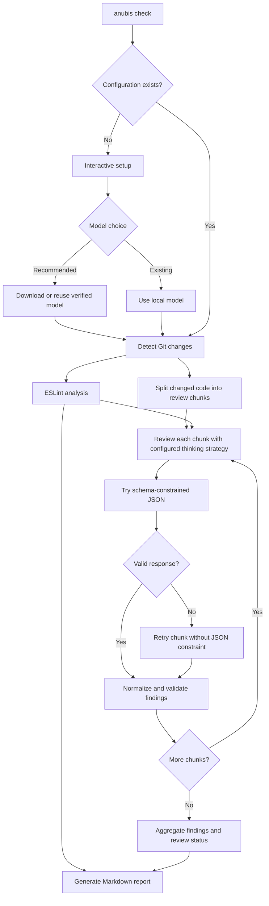

<div align="center">


# Anubis

### Before the Merge Comes the Judgment.

**AI-Powered Code Review · 100% Local · Built for React Native**

Local AI-Powered code review tool that "weighs" every line of code to judge its quality and integrity before it moves forward in your project's lifecycle.

Anubis reviews your Git changes, combines ESLint with local AI analysis, and produces an actionable Markdown report—without uploading your source code to a hosted AI service.

[Quick Start](#-quick-start) · [Features](#-features) · [Model Recommendations](#-model-recommendations) · [Configuration](#%EF%B8%8F-configuration) · [Roadmap](#%EF%B8%8F-roadmap)

</div>

---

## ⚖️ Why Anubis?

In ancient Egyptian mythology, Anubis weighed the heart to judge what lay beneath the surface. Anubis applies the same idea to code: looking beyond formatting and syntax to identify behavioral problems before changes are merged.

Linters are essential, but they don't catch every lifecycle issue, asynchronous race condition, or unintended consequence of a change. Anubis combines **static analysis** with **AI-assisted review**, focused on the kinds of bugs React Native developers encounter in real projects.

> [!IMPORTANT]
> Anubis is an assistant, not a substitute for human review or automated tests. AI findings and suggested fixes can be wrong or incomplete; verify them before applying changes.

## ✨ Features

- **🔒 Private by design:** Code review runs on your computer. No hosted AI API, API key, or account is required for the recommended model.
- **🌍 Cross-platform by design:** Built to run locally on macOS, Windows, and Linux. Compatibility and performance may vary depending on your hardware and system configuration..
- **⬇️ Automatic model setup:** Download the recommended model directly during initialization, with progress tracking and integrity verification.
- **♻️ Download once, reuse everywhere:** Share one locally cached model across multiple projects instead of downloading it for each repository.
- **⚛️ React Native-focused:** Review Hooks, cleanup, navigation, async flows, security, accessibility, and meaningful performance concerns.
- **🌿 Git-aware:** Detect staged, unstaged, and untracked JavaScript and TypeScript changes.
- **🔍 ESLint + AI:** Use your project's ESLint configuration where possible, or bundled fallback rules. The AI is instructed to avoid duplicating ESLint findings and focus on deeper runtime issues, but this is best-effort and depends on the model.
- **🧠 Configurable thinking strategy:** Choose auto, bounded, unbounded, or zero thinking budget during setup to control model generation behavior.
- **🧩 Chunked code review:** Review larger changed files in sequential chunks, with original line numbers and overlapping context instead of relying on a single truncated source excerpt.
- **🧩 Resilient structured output:** Request schema-constrained JSON first; if that attempt fails, retry without the constraint and normalize supported response variations.
- **📊 Actionable reports:** Get severity, file and line, issue, impact, and suggested fix in a branded Markdown report.
- **🛠️ Simple CLI:** Initialize once and run reviews with `anubis check`.
- **♾️ No usage quotas or subscriptions:** Run as many local reviews as your hardware can handle. No credits to buy, no rate-limit countdowns, and no “come back later” messages. Your GPU might ask for a coffee break, though. ☕

## 🚀 Quick Start

### Prerequisites

- **Node.js:** A supported Node.js version compatible with the installed Anubis package.
- **Git:** Run Anubis inside a Git repository.
- **A React Native project:** Current change detection supports `.js`, `.jsx`, `.ts`, and `.tsx`.
- **Available memory and disk space:** The recommended model is a multi-gigabyte download and needs additional memory to run. Performance depends on your hardware.
- **Internet access for first-time setup:** Required to download the recommended model; subsequent reviews run locally.

### 1. Install Anubis

**After the package is published to npm:**

```bash
npm install --global <published-package-name>
```

> Replace `<published-package-name>` with the actual npm package name when published. Until then, use the local development instructions below.

**For local development:**

```bash
git clone <repository-url>
cd <repository-directory>
npm install
npm run build
npm link
```

### 2. Initialize in your React Native project

```bash
cd path/to/your-react-native-project
anubis init
```

Choose the recommended model when prompted:

```text
⚖️ Anubis Initial Setup

Choose your AI model:
  1. Download Qwen3.5-4B Q6_K (Recommended)
  2. Use an existing local model

Select an option (1):

The recommended model is a multi-gigabyte download.
Download or reuse this model? [Y/n] (Y):

⬇️  Downloading: ...
✔ Model downloaded and verified.

Context size (8192):
Temperature (0):
Max output tokens (3072):

Choose thinking mode:
  1. Auto (Default)
  2. Bounded
  3. Unbounded
  4. Zero thinking budget
Select an option (1):

Report filename (ANUBIS_REPORT.md):

✅ Anubis initialized successfully!
```

If you select **Bounded** thinking (option `2`), Anubis also prompts for `Thinking token budget (1024):`. Other modes skip that question. The **Zero** option sets a zero thinking budget; it does not necessarily disable a model's internal reasoning behavior.

Anubis supports model-specific generation strategies, but the exact behavior depends on the GGUF model and its chat template.

Press **Enter** to accept the other defaults. Anubis downloads the recommended model from [Hugging Face](https://huggingface.co/lmstudio-community/Qwen3.5-4B-GGUF), verifies its integrity, and saves it in a shared local cache at `~/.anubis/models/`.

If the model has already been downloaded and passes verification, Anubis reuses it. Initialization creates `anubis.config.json` in the current project and does not overwrite an existing configuration.

### 3. Review your changes

```bash
anubis check
```

Anubis analyzes the detected changes and writes **`ANUBIS_REPORT.md`** to your project by default. Subsequent reviews replace the report at the configured output path.

**Prefer one command?** If configuration is missing, `anubis check` starts the interactive setup automatically, then continues with the review. Interactive setup requires a terminal.

## 🧠 Model Recommendations

Anubis supports compatible local GGUF models, giving you the freedom to choose the model that best fits your hardware and review needs.

**Qwen3.5-4B Q6_K is our recommended default because it delivered the most promising results among the models we tested during Anubis development.** It provides a convenient, ready-to-use starting point through Anubis's automatic download and setup process.

However, **this recommendation is based on our own testing, not an exhaustive comparison of available models.** Other models, including larger or newer ones, may deliver better accuracy, more useful findings, or stronger performance for your specific codebase.

| Model tested | Observations from our tests | Recommendation |
| --- | --- | --- |
| **Qwen3.5-4B — Q6_K** | Most promising overall results in our hands-on React Native review tests, including more useful suggested fixes. | **Default recommendation** |
| **Qwen2.5-Coder-1.5B-Instruct — Q6_K** | Produced structured findings, but largely repeated ESLint results, overestimated severity, and provided limited additional analysis of runtime issues. | Not the default |
| **Qwen2.5-Coder-0.5B-Instruct — Q6_K** | Successfully generated valid structured JSON, but returned no AI findings in our test despite identifiable security and performance concerns. | Not the default |
| **Gemma-1.1-2B-IT** | Less consistent review quality and suggested fixes in our tests. | Not the default |
| **DeepSeek-Coder-1.3B-Kexer** | Kotlin-focused fine-tuned model; less reliable findings and suggested fixes in our React Native tests. | Not the default |

**Quick start:** Choose the recommended model during `anubis init`, and Anubis will automatically download, verify, and configure it for you.

**Prefer to experiment?** You're free to use another compatible GGUF model. Different models and quantizations may produce different results, so we encourage you to experiment and find what works best for your projects and hardware.

**Recommended download:** [Qwen3.5-4B Q6_K on Hugging Face](https://huggingface.co/lmstudio-community/Qwen3.5-4B-GGUF). Anubis handles the download automatically during setup.

> [!NOTE]
> **These were exploratory, hands-on tests, not a controlled benchmark.** We intentionally experimented with models of different parameter sizes, quantizations, and training specializations to find a practical default for Anubis, rather than conduct a like-for-like comparison.
>
> The Qwen2.5-Coder models were tested using the Instruct variants with Q6_K quantization. Although both successfully generated structured output, their review quality was less reliable in our test cases. These observations should not be interpreted as a general assessment of their coding capabilities.
>
> In particular, DeepSeek-Coder-1.3B-Kexer was fine-tuned for Kotlin code generation rather than React Native code review. Its results should be interpreted in that context.
>
> Our recommendation reflects the results observed during development, not a claim that Qwen3.5-4B Q6_K is inherently superior to other models. Different models, configurations, and hardware may produce better results, and AI findings can still be inaccurate or incomplete.

**Model attribution:** The recommended [Qwen3.5-4B](https://huggingface.co/Qwen/Qwen3.5-4B) model is developed by the Qwen team and licensed under [Apache License 2.0](https://www.apache.org/licenses/LICENSE-2.0). Anubis is an independent project licensed separately under the MIT License.

### Why Q6_K?

**Q6_K is the quantization used for our successful Qwen3.5-4B tests.** We recommend the configuration we actually tested rather than assuming a smaller download produces equivalent code review results.

Smaller quantizations may require less memory and work better on devices with limited resources. However, we haven't tested them extensively with Anubis, so review quality may vary.

## 🧰 CLI Reference

| Command | What it does |
| --- | --- |
| `anubis init` | Interactive first-time setup and configuration |
| `anubis check` | Review detected Git changes and generate a report |
| `anubis --help` | Show available commands |
| `anubis --version` | Show the CLI version |

### Debugging

```bash
ANUBIS_DEBUG=1 anubis check
```

Debug mode prints the prepared review context and raw AI responses, including the structured-output attempt and fallback when applicable.

> [!CAUTION]
> Debug logs may contain proprietary source code and sensitive application details. Review and sanitize them before sharing.

## ⚙️ Configuration

Initialization generates an `anubis.config.json` file. For most users, the defaults are sufficient.

```json
{
  "model": {
    "path": "/home/you/.anubis/models/<downloaded-model-file>",
    "contextSize": 8192,
    "temperature": 0,
    "maxTokens": 3072,
    "thinkingMode": "auto",
    "thoughtTokens": 1024
  },
  "review": {
    "output": "ANUBIS_REPORT.md"
  }
}
```

The example path is illustrative; Anubis writes the real path for your machine.

| Setting | Purpose | Default |
| --- | --- | --- |
| `model.path` | Location of the model on your computer | Automatically set during recommended setup |
| `model.contextSize` | Amount of context available to the model | `8192` |
| `model.temperature` | Controls generation randomness | `0` |
| `model.maxTokens` | Maximum generated output tokens | `3072` |
| `model.thinkingMode` | Thinking strategy: `auto`, `bounded`, `unbounded`, or `zero` | `auto` |
| `model.thoughtTokens` | Thinking token budget used by budget-aware generation modes | `1024` |
| `review.output` | Markdown report name or relative path | `ANUBIS_REPORT.md` |

**Thinking modes:** `auto` uses Anubis's automatic strategy, `bounded` uses the configured thinking-token budget, `unbounded` does not impose that budget, and `zero` requests a zero thinking budget. Actual behavior varies by model; `zero` is not a guarantee that reasoning is disabled. For a bounded run, Anubis asks for `thoughtTokens` during initialization.

The output can also be a relative path such as `reports/ANUBIS_REPORT.md`; Anubis creates the required directory.

**Team tip:** Model paths are machine-specific. Consider excluding `anubis.config.json` from version control if contributors have different local paths.

## 📊 Review Report

Each review produces a branded Markdown report with:

- **Review Summary:** Total static-analysis issues, ESLint errors and warnings, AI findings broken down by critical, high, medium, and low severity, and AI completion status.
- **Static Analysis:** ESLint findings with file locations, rule names, and descriptions.
- **AI Code Review:** Severity-ranked findings with issue, impact, and suggested fix.
- **Source links:** Relative links to affected files, with line anchors in viewers that support them.
- **Failure visibility:** An explicit AI failure status and error details when the AI stage cannot complete.

Example AI finding (*illustrative — fictional code*):

```markdown
### 🟠 1. HIGH

**📍 Location:** [UserProfile.tsx:42](src/screens/UserProfile.tsx#L42)

**🐛 Issue**

An earlier profile request can finish after a newer one and overwrite the
screen with stale user data.

**⚠️ Impact**

Switching between profiles quickly may display information belonging to the
previously selected user.

**💡 Suggested Fix**

Ignore outdated responses or cancel the previous request when the user ID
changes, and update state only for the latest active request.
```

> Relative file links work across many Markdown viewers, but navigating to an exact line depends on the viewer. GitHub supports `#L` line anchors.

## 🔄 How Anubis Works



Anubis follows these principles:

1. **Review changes, not everything:** Analyze staged, unstaged, and untracked JavaScript/TypeScript files.
2. **Use static analysis as context:** Pass ESLint findings alongside the changed code. The AI is instructed not to repeat findings with the same root cause and impact, while still reporting deeper runtime bugs that ESLint may only hint at.
3. **Review in chunks:** Split larger changed files into line-scoped chunks with overlapping context. Keep original source line numbers so findings point to real locations; review each chunk separately.
4. **Apply React Native review guidance:** Focus on supported, actionable runtime and lifecycle concerns.
5. **Control generation:** Apply the configured thinking strategy and token budget where supported by the model.
6. **Prefer structured output:** Request JSON matching the findings schema for each chunk. If that attempt fails, retry with a fresh model context without the JSON constraint, then parse supported response variations.
7. **Report failures honestly:** Continue processing other chunks when a chunk fails, preserve available static-analysis results, and indicate partial or failed AI review status rather than treating missing results as a clean review.

## 🔐 Privacy & Offline Reviews

**Your code stays on your machine during review.** Anubis does not need a hosted AI service, an API key, or an account to analyze your changes. After the model and package are installed, the review workflow does not require an internet connection.

The initial model download connects to Hugging Face. As with any developer tool, evaluate dependencies and local environment policies before using it with confidential repositories.

## 🧪 Advanced: Using a Custom AI Model

If you already work with local AI models, select **Use an existing local model** during `anubis init`.

Anubis currently accepts compatible quantized models in **GGUF format (`.gguf`)**. Other model file formats are not supported. Provide an absolute or relative path to an existing `.gguf` file, or use a `~/` path on macOS/Linux.

```text
Choose your AI model:
  1. Download Qwen3.5-4B Q6_K (Recommended)
  2. Use an existing local model

Select an option (1): 2
Enter the absolute or relative path to your GGUF model: ~/models/my-model.gguf
```

Compatibility and output quality vary by model. The JSON constraint and automatic fallback improve output handling but **do not guarantee** that every model will follow instructions, produce valid findings, or return accurate suggested fixes.

## ⚠️ Current Limitations

- **Chunking is currently line-based, not syntax-aware.** Larger files are divided into overlapping line ranges, but a chunk can still miss declarations or related code outside its context. AST-aware chunking and dependency-aware context are planned.
- **Chunk size is not yet token-aware.** Chunking reduces source truncation but does not guarantee that every chunk fits every model's context window or that cross-file dependencies are included.
- **AI findings are not authoritative.** Models may miss bugs, report false positives, or propose unsafe fixes.
- **Structured output is not infallible.** Some reasoning models may emit JSON in a thinking segment rather than the final answer. Anubis retries without the JSON constraint; failed chunks are reflected in the AI status.
- **Thinking controls are model-dependent.** A zero budget does not necessarily disable thinking, while unbounded thinking may consume the output-token allowance before a usable final response is produced.
- **Changed files only.** This is not a full-repository security audit or a replacement for tests.
- **JavaScript/TypeScript scope.** Native iOS/Android source files are not currently included in Git change detection.
- **Hardware-dependent performance.** Inference speed and memory use vary by device and model.
- **Markdown line links vary by viewer.** Not every viewer jumps to the referenced line.

## 🛠️ Troubleshooting

<details>
<summary><strong>Model download fails</strong></summary>

Check your connection, available disk space, and access to Hugging Face. The downloader verifies the file before making it available for use and removes incomplete temporary downloads. Retry `anubis init` after resolving the issue.

</details>

<details>
<summary><strong>An existing model fails integrity verification</strong></summary>

The cached model does not match the expected checksum. Move or delete the reported file and run initialization again to download a verified copy.

</details>

<details>
<summary><strong>The model returns an empty or invalid response</strong></summary>

Anubis automatically retries without the JSON constraint when the first attempt fails. If both attempts fail, inspect the AI error details in the report and use `ANUBIS_DEBUG=1 anubis check` for additional diagnostics. Review `model.thinkingMode` and `model.thoughtTokens` as well as `maxTokens` and `contextSize`. Some reasoning models can spend their full generation budget on thought tokens and return no final JSON. Bounded thinking may help, but accuracy and behavior vary by model.

</details>

<details>
<summary><strong>No changed files detected</strong></summary>

Check `git status --short`. Anubis looks for changed `.js`, `.jsx`, `.ts`, and `.tsx` files, not a full scan of every file in the repository.

</details>

<details>
<summary><strong>ESLint uses bundled fallback rules</strong></summary>

Anubis tries to use your project's ESLint setup first. If it cannot, it may use bundled rules. Check the report's ESLint configuration field.

</details>

<details>
<summary><strong>The report logo is missing</strong></summary>

Ensure the installed Anubis package includes `assets/Anubis_Report.png`. Keep the generated `.anubis-assets/` directory beside the report.

</details>

<details>
<summary><strong>Initialization fails in CI</strong></summary>

Interactive initialization requires a terminal. Configure Anubis before running it in a non-interactive environment, and make sure the configured model file exists on the runner.

</details>

<details>
<summary><strong>AI findings appear incorrect or refer to missing state</strong></summary>

Line-based chunks can omit declarations that appear elsewhere in the file. Check the original source and the chunk boundaries in debug mode before acting on a finding. AST-aware and dependency-aware chunking, plus finding verification, are planned improvements.

</details>

## 🗺️ Roadmap

**Implemented in the current MVP**

- [x] Git-aware change detection
- [x] ESLint integration with fallback rules
- [x] React Native-focused review guidance
- [x] Automatic recommended-model download, caching, and checksum verification
- [x] Interactive initialization and auto-init, including thinking-mode selection
- [x] Line-based code-review chunking with original line numbers and overlapping context
- [x] Per-chunk AI review with partial-failure visibility
- [x] Configurable thinking strategy and token budget
- [x] Schema-constrained JSON output with automatic fallback
- [x] Flexible response normalization and validation
- [x] Branded Markdown report with actionable findings

**Planned**

- [ ] **AST-aware chunking:** Group code by functions, components, and syntax boundaries rather than arbitrary line ranges, with a line-based fallback.
- [ ] **Dependency-aware context:** Include relevant state, props, imports, and related definitions across chunk boundaries; investigate cross-file context selection.
- [ ] **Token-aware chunk sizing:** Adapt chunk budgets to model context limits and prompt overhead.
- [ ] **Finding verification:** Check AI claims against the original source and filter unsupported findings; evaluate suggested fixes for correctness.
- [ ] **VS Code extension:** Bring Anubis code review capabilities directly into the VS Code development workflow.
- [ ] **Few-shot prompting:** Use curated React Native examples to improve finding accuracy and consistency.
- [ ] **Automated testing and model evaluation:** Expand test coverage, validate model compatibility, and measure review quality.
- [ ] **CI/CD integration:** Support non-interactive workflows, configurable severity thresholds, and exit codes for automated quality gates in CI/CD pipelines and Git hooks.
- [ ] **Reporting and integrations:** Support additional report formats and integration options.

## 🤝 Contributing

Contributions, issues, and suggestions are welcome when the repository is public.

```bash
npm install
npm run build
npm test
npm link
```

When reporting model-related issues, include your operating system, Node.js version, model name and quantization, and **sanitized** error logs. Never share confidential code or raw debug logs without permission.

## 📄 License

Anubis is licensed under the [MIT License](LICENSE).

Copyright © 2026 Hossam Abdel-Aziz.

---

<div align="center">

**⚖️ Anubis — AI-Powered Code Review**

*Before the Merge Comes the Judgment.*

</div>
